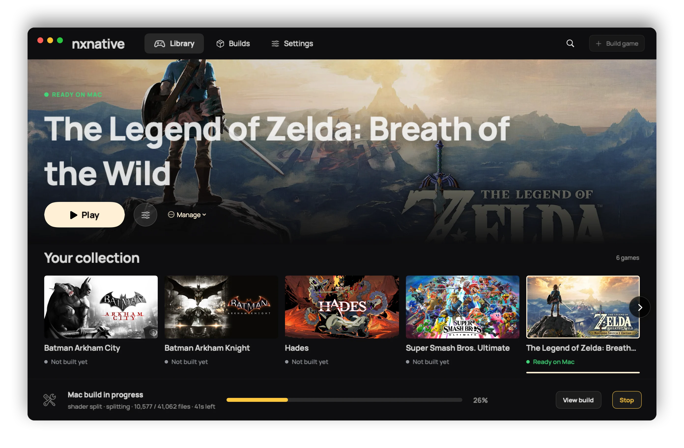
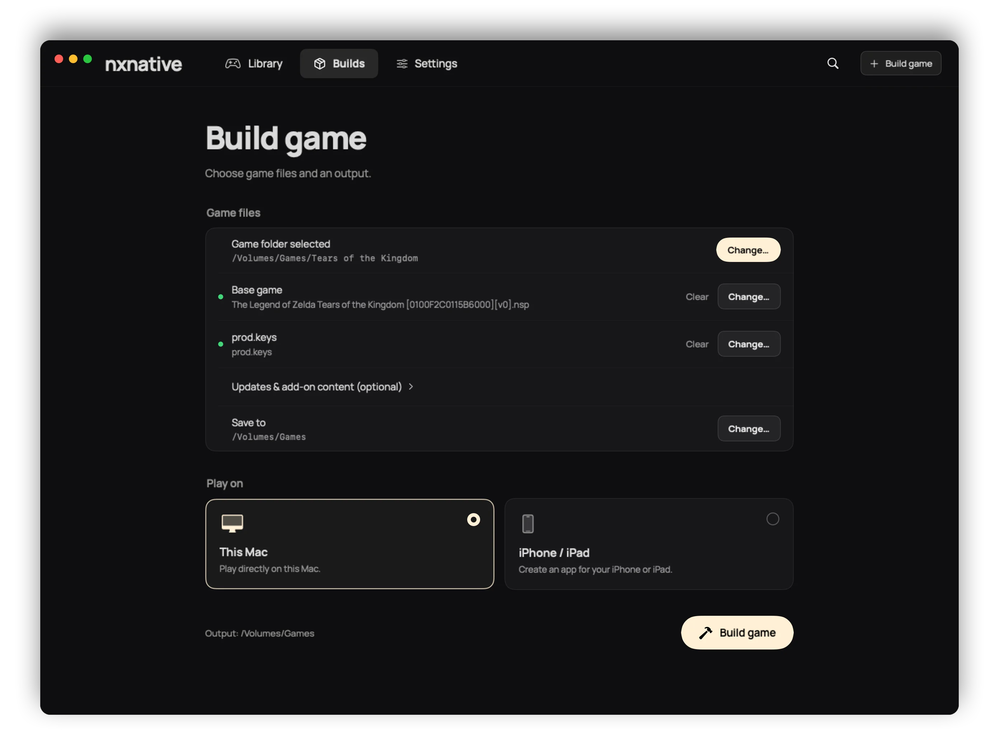
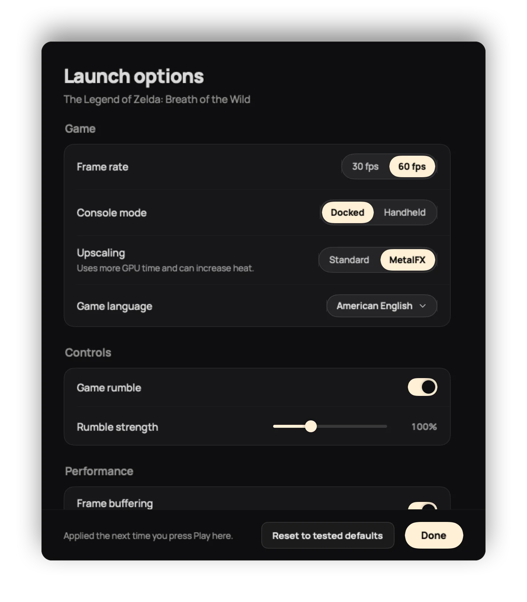

# nxnative for Mac

The native macOS front end for building games from your own Switch files, with a
library for playing the finished Mac apps. The interface is designed around
building a game, rather than manually importing finished apps.



 

The screenshots are rendered by the app's own views: `NX_LAUNCHER_README_DIR=<dir>
NX_LAUNCHER_README_SETTINGS=<a Mac launcher.json> swift test --filter testReadmeScreenshots`
writes them as PNG (from a copy of your library, with example paths), and
`cwebp -q 86 -alpha_q 100 -m 6` makes the WebP files here.

## Build game

1. Select **Build game** and choose the folder containing one game's files, or
   pick the base game and `prod.keys` separately. Dropping NSP, NSZ or XCI files,
   a folder or `prod.keys` onto the page does the same: they are sorted into base
   game, update and DLC by the title ID in their names, as a chosen folder is.
2. Add an update or DLC under **Updates & add-on content** when needed.
3. Choose **This Mac** or **iPhone / iPad**, then **Build game**.

Setup lives under **Settings**: the games folder, the repository and its updates,
the dependency checks and installers, and app updates. Missing setup is linked
from the build screen. The progress shows each of the script's steps with its
count, the time it has been running and, while the script's estimate lasts, the
time left; the build log opens under it. **Stop** ends the script and every tool
it started (the build runs in a process group of its own), and so does quitting
the app.

A completed Mac build appears in the collection automatically and can be started
with **Play**. An iPhone build, by default, offers its unsigned IPA and the
sideloading and RomFS-copy instructions.

## Install on an iPhone or iPad

With Xcode, a development certificate (sign in to Xcode with your Apple ID under
Settings → Accounts) and a device paired with this Mac, an iPhone build can go
straight to the device: choose it under **Install on** and the **Signing team**
next to it. The script then prepares the game's Xcode project
(`--prepare-xcode --team-id`, the route it offers developers) instead of an IPA,
`xcodebuild -allowProvisioningUpdates` signs it for that device with the team
(Xcode makes the provisioning profile), and `xcrun devicectl device install app`
installs it. The game files take the same route as for sideloading. They are packed into
`games/<title ID>/romfs.img`, with any DLC in `aoc/` beside it, and the app is built
without them (`DM_COPY_ROMFS=NO`). After the install, `xcrun devicectl device copy to`
puts that folder into the app's `Documents/games/<title ID>/`, where the app looks first. devicectl skips files
that did not change, so a reinstall sends the code and shaders, not the whole game
again. The first copy of a large game takes a few minutes. The game then appears
in the collection, and its button opens it on the device.

The first time, turn on Developer Mode on the device and trust the developer
under Settings → General → VPN & Device Management. With a free Apple ID the
profile expires after seven days. **Don't install, export the IPA** keeps the
unsigned IPA as before. The devices and teams are read with `devicectl list
devices` and `security find-identity`; the team is the certificate's
organizational unit, not the code in its name.

## Your games folder

Set **Your games folder** in Settings once. The launcher remembers it, checks it
on startup, and uses it as the default output location for new builds. **Refresh**
looks for existing nxnative Mac game apps, including apps in subfolders up to four
levels deep. It skips game contents, extraction folders and build caches. It does
not copy or move the games. Several builds of the same title occupy one entry;
an already linked, valid build keeps its location.

Readiness is checked against each app's title ID and executables. Ready games are
green, building games are yellow, and games without a finished output are gray.
Removing a collection entry leaves its game and source files on disk. The small
library manifest is stored at
`~/Library/Application Support/NS Port Builder/library.json`.

## Launch options

The button beside **Play** opens the game's launch options: the settings the iPhone
launcher shows before a game starts ([docs/settings.md](../docs/settings.md)), read
from the list the engine packs into the Mac app (`Contents/Resources/dm/launcher.json`,
written by `dm/games/settings.py` from `dm/games/settings.tsv`; the engine change that
packs it is [seedds/nxnative#352](https://github.com/seedds/nxnative/pull/352), so a
sync from upstream brings it). **Play** starts the app with every setting in its
environment. Only a choice that differs from the game's tested default is kept, in the
library manifest; **Reset to tested defaults** forgets them. An app without the list
shows none. Starting the app from Finder uses its defaults.

## Controls

**Settings → Controls → Customize…** sets the keys and controller buttons for every game.
For a key, click its field and press the new key (Esc keeps the old one, × leaves the
function on no key). One key holds one function, so the function that had the key before
is left on none, as in the host. For a controller button, choose the button it sends
(A and B swapped, for example). The right stick has no keys by default and can get some
here. **Play** passes only the changes, as `DM_KEYMAP` and `DM_PAD_MAP`, which the host
reads through `dm/host/input_map.h` — upstream's
[seedds/nxnative#386](https://github.com/seedds/nxnative/pull/386), carried in this fork
while it is open, and listed in `docs/env_switches.tsv`. A host built before the carrier
has no `input_map.h` and ignores both, so its games play with the default keys.

## Artwork

The launcher shows, in this order: a custom image chosen under **Manage > Change
artwork**; the game's eShop key art (1920×1080 from Nintendo's image CDN, found by
title ID in the community title database
[blawar/titledb](https://github.com/blawar/titledb)); a matching gameplay screenshot
from the repository; the built app's icon. The title list (about 90 MB) is
downloaded only while a game in the collection has no key art yet, reduced to title
ID → image and kept with the images in
`~/Library/Application Support/NS Port Builder/artwork/`. Custom images stay at
their chosen path.

## Type

The interface is set in Manrope (SIL Open Font License; `fonts/`, with its license):
headings, text and a game's status line, whose capitals are the same face, tracked.
Paths and the build log use the system's monospaced face. `python3 fonts/embed_fonts.py`
writes the font into the binary as `Sources/NSPortBuilder/EmbeddedFonts.swift`, so the app needs no font
installed and no resource bundle beside the executable.

The app icon is drawn by `make_icon.swift`; `./make_icon.sh` writes `icon.iconset/`
and `AppIcon.icns` from it.

## Run

```bash
cd frontend
swift run
```

or double-click `nxnative.app` in this folder (ad-hoc signed; rebuild it with `swift build -c release`
and copy the binary into `Contents/MacOS/`). The app's settings and library stay under the folder name it
had before the rename, `~/Library/Application Support/NS Port Builder/`.

SwiftUI, macOS 13+.

### Why the dependency check does not use `which`

A GUI app does not inherit the shell's PATH. On a machine where a terminal sees
`.NET` and the Python packages just fine, a naive `which dotnet` and
`/usr/bin/python3` check reports both missing. So the app looks where the tools
actually are (`~/.dotnet`, `/usr/local/share/dotnet`, the Python framework
installs), verifies `.NET` with `--list-sdks` (the extractor targets `net10.0`),
and picks the first interpreter that can really import
`lz4 capstone fontTools backports.zstd`. That same interpreter then runs the
build.

## Language

The interface follows the system language at every launch: any Chinese variant
(Simplified, Traditional, Hong Kong, Taiwan) gets Chinese, every other language gets
English; the app has no language switch. Strings live in
`Sources/NSPortBuilder/Localization.swift`; regenerate the Qt table after editing
it with `python3 frontend-qt/gen_localization.py` from the repository root.

## Verification

```bash
swift test --package-path frontend
```

The Swift tests cover bundle validation, persistent metadata, folder discovery,
source-file preservation, and automatic registration through a synthetic build
process, including when the window is hidden. Set `NX_LAUNCHER_CAPTURE_DIR` to
capture the native library, build, settings, empty and active-build views for
visual QA. Capture fixtures are isolated from the user's library and never run a
real game build.
